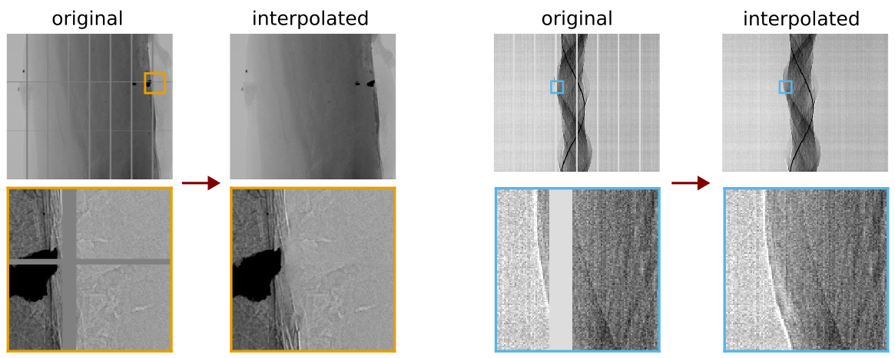

# detectorGapRemoval_Pix2Pix

Inpainting of detector gaps in X-ray projections and sinograms with a Pix2Pix GAN.



Tiled photon-counting detectors (e.g. the DECTRIS Pilatus3 2M) have insensitive gaps between their
modules: whole rows and columns of every projection are missing. The generator, a U-Net, gets the
image with its gaps linearly interpolated plus the gap mask, and predicts a correction inside the
gaps only; valid pixels pass through unchanged. It is trained adversarially against a PatchGAN
discriminator, with an MSE, a gap-mean and a histogram (Earth Mover's Distance) loss.

## Installation

Install PyTorch with CUDA support for your system first; see [pytorch.org](https://pytorch.org).

```bash
git clone https://github.com/J-3TO/detectorGapRemoval_Pix2Pix.git
cd detectorGapRemoval_Pix2Pix
pip install -r requirements.txt
```

## Inference

[`inference_example.ipynb`](inference_example.ipynb) downloads the pretrained weights and
inpaints a simulated projection stack. In short:

```python
from gap_pix2pix import inpaint, inpaint_sinograms, load_generator, pilatus3_2m_gap_mask

generator = load_generator("hf", device="cuda")   # pretrained weights, or a path to a .pth / .ckpt
mask = pilatus3_2m_gap_mask()                     # (1475, 1679) bool, True = gap
filled = inpaint(projections, mask, generator)            # every projection on its own
filled = inpaint_sinograms(projections, mask, generator)  # gap columns in the sinograms
```

The input are flat-field corrected projections `(N, H, W)`. For other detectors,
`detector_gap_mask(module_size, gap_size, grid)` builds the mask of a regular module grid.

The pretrained weights are on the Hugging Face Hub,
[J-3TO/detectorGapRemoval_Pix2Pix](https://huggingface.co/J-3TO/detectorGapRemoval_Pix2Pix):
`pix2pix_projections_sinograms_generator.pth` (generator, for inference) and
`pix2pix_projections_sinograms_full.pth` (generator + discriminator, to continue training). Only
the file that is needed is downloaded, when `hf` or `hf:<file name>` is given as weights.

## Training

### Data

The data are `.npy` arrays of gap-free images (any dtype; read memory-mapped). Three kinds of
sources are mixed, each with a weight in [`config.yml`](config.yml):

| source | file shape | patches |
|---|---|---|
| `projections` | `(N, H, W)`, e.g. the projections of single detector modules | random 256 × 128 patches; horizontal, vertical and crossing gaps |
| `sinograms` | `(detector rows, angles, detector columns)` | a detector row and 256 angles inside one gap-free module (`modules: pilatus3_2m` or a list of `[row0, row1, col0, col1]` boxes); vertical gaps only |
| `images` | a folder of natural images (optional) | grayscale random patches |

Every patch is z-scored, gets a synthetic gap 7–40 px wide and is augmented (Poisson noise, blur,
flips). Projections and sinograms are stored as separate files because a `.npy` volume can only be
read quickly along its last axes: in a `(rows, angles, columns)` volume a sinogram patch is one
contiguous read, a projection patch hundreds of scattered ones.

### Train from scratch or continue training

All settings are in [`config.yml`](config.yml). Set the data paths there, then run

```bash
python3 train.py --config config.yml
```

Where training starts is set by two entries in the config:

| setting | effect |
|---|---|
| `init_weights:` (empty) | train from scratch |
| `init_weights: hf:pix2pix_projections_sinograms_full.pth` | start from the released model, e.g. to fine-tune on your own data (fresh optimizers) |
| `resume: runs/gap_inpainting/version_0/checkpoints/last.ckpt` | continue an interrupted run exactly where it stopped (weights, optimizers, epoch) |

`init_weights` also takes a generator `.pth` (the discriminator then starts from scratch) or a
Lightning `.ckpt` of an earlier run. The GPUs are selected with `devices` in the `trainer`
section, e.g. `[0, 1]`. Each run writes to
`runs/<name>/version_<k>/`: checkpoints every `checkpoint_every_n_epochs` epochs and `last.ckpt`,
`metrics.csv`, previews of validation patches (input | prediction | target) and a copy of the
config. A checkpoint can be used for inference directly: `load_generator("runs/.../last.ckpt")`.

## Citation

TODO: add the reference of the paper.

## License and acknowledgements

The code and the pretrained weights are licensed under the GNU General Public License v3.0
([LICENSE](LICENSE)). If you use them, please cite the paper (see [Citation](#citation)).

- The U-Net building blocks follow [milesial/Pytorch-UNet](https://github.com/milesial/Pytorch-UNet)
  (GPL-3.0).
- The histogram metric is adapted from [ADL](https://github.com/mogvision/ADL) (MIT license; the
  notice is in [`gap_pix2pix/losses.py`](gap_pix2pix/losses.py)).
- Pix2Pix: Isola et al., *Image-to-Image Translation with Conditional Adversarial Networks*,
  CVPR 2017.
